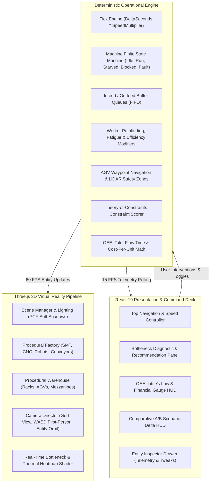
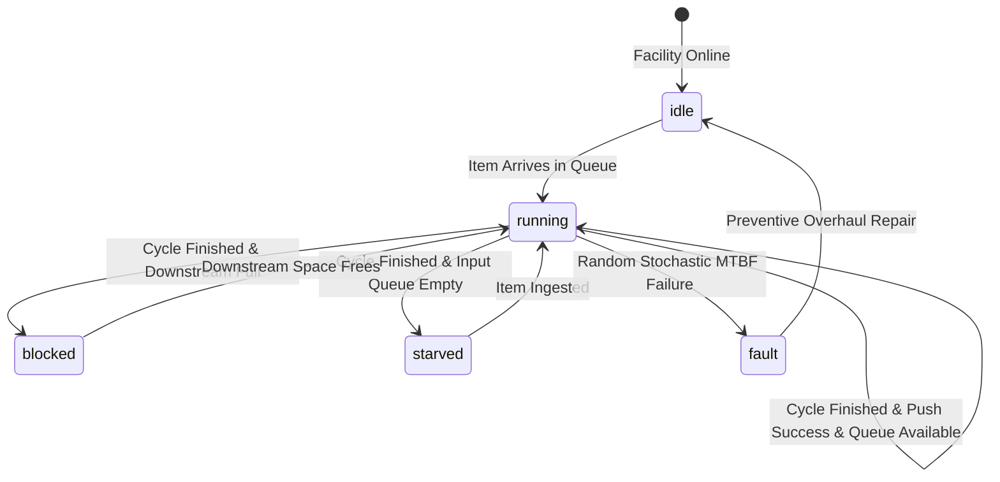

# 🏛️ MIRRORWORLD Architecture & Technical Design Document
## Deterministic Discrete-Event Queue Engine, Theory-of-Constraints Bottleneck Detection & WebGL Digital Twin

> 📌 **Purpose:** Technical specification and engineering reference for the MIRRORWORLD industrial simulation engine, Three.js 3D WebGL kinematics visualizer, and Theory-of-Constraints operational optimization platform.

---

## 📋 Document Properties

| Attribute | Specification |
| :--- | :--- |
| **System** | MIRRORWORLD Simulation Engine |
| **Document Version** | `2.4.0` |
| **Target Architecture** | Client-Side Deterministic Digital Twin |
| **Engine Type** | Hybrid Discrete-Event Simulation (DES) + Continuous Kinematics |
| **Rendering Pipeline** | Three.js WebGL2 + Directional Shadow Mapping + ACES Filmic Tone Mapping |
| **State Synchronization** | Decoupled 60 FPS Three.js Render Loop + 15 FPS React Polling Ticker |
| **Last Updated** | `2026-11-16` |

---

## 🧭 Table of Contents

- [1. System Architecture Overview](#1-system-architecture-overview)
- [2. Deterministic Discrete-Event Simulation (DES) Core](#2-deterministic-discrete-event-simulation-des-core)
- [3. Theory of Constraints (TOC) Algorithmic Engine](#3-theory-of-constraints-toc-algorithmic-engine)
- [4. Three.js Procedural WebGL Scene Graph](#4-threejs-procedural-webgl-scene-graph)
- [5. Performance Optimization & Decoupled State Model](#5-performance-optimization--decoupled-state-model)
- [6. Verification & Test Architecture](#6-verification--test-architecture)

---

## 1. 🏗️ System Architecture Overview

---

## 2. ⚙️ Deterministic Discrete-Event Simulation (DES) Core

### Finite State Machine (FSM) Per Workstation
Every machine entity implements an isolated state machine with 5 discrete operational states:
1. `idle`: Machine has no active item and zero input queue.
2. `running`: Machine has active item and is advancing progress ($P \in [0, 1]$).
3. `starved`: Machine completed prior cycle, but upstream buffer has no incoming items.
4. `blocked`: Machine completed prior cycle, but downstream station buffer is full ($Q_{downstream} \ge Q_{max}$).
5. `fault`: Mechanical failure or thermal trip occurred; machine halted until technician overhaul.

---

## 3. 🎯 Theory of Constraints (TOC) Algorithmic Engine

### Goldratt Constraint Scoring Equation
To autonomously diagnose which machine represents the governing line constraint without human bias, the engine calculates a composite constraint score $S_c$ across all machines:

$$S_c = 0.35 \left(\frac{C_t}{T_{takt}}\right) + 0.25 (U) + 0.20 (B_{upstream}) + 0.15 (S_{downstream}) + 0.15 (Q_{fill}) - 0.30 (S_{self})$$

Where:
- $C_t$: Active machine cycle time in seconds.
- $T_{takt}$: Current customer demand takt time ($T_{takt} = \frac{\text{Net Available Time}}{\text{Demand Rate}}$).
- $U$: Active machine utilization percentage ($\frac{T_{run}}{T_{total}}$).
- $B_{upstream}$: Blockage ratio imposed on the immediate upstream workstation.
- $S_{downstream}$: Starvation ratio imposed on the immediate downstream workstation.
- $Q_{fill}$: Current input buffer fill percentage ($\frac{\text{Queue Length}}{\text{Max Capacity}}$).
- $S_{self}$: Machine's own starvation percentage (subtracted to prevent false positives on downstream "victim" stations).

---

## 4. 🌐 Three.js Procedural WebGL Scene Graph

- **Zero External Heavy Asset Dependencies:** Every machine, pallet rack, AGV, robot arm, conveyor belt, and worker is generated procedurally using optimized Three.js geometries and PBR materials (`MeshStandardMaterial` and `MeshPhysicalMaterial`).
- **Dynamic Andon Lights:** Each machine features an industrial 3-color Andon beacon light coupled with a localized `THREE.PointLight` that shifts dynamically based on machine status (Green = Normal, Amber = Starved/Warning, Red = Blocked/Fault).
- **Kinematic Animators:**
  - 6-axis robotic arm with forward kinematic joint rotation.
  - Rotating CNC spindle ($>20\text{ rad/s}$) with coolant mist enclosure.
  - Optical laser fan sweeping across inspection bays.
  - AGV LiDAR pucks spinning at $15\text{ rad/s}$ with projected ground safety arcs.

---

## 5. ⚡ Performance Optimization & Decoupled State Model

### Dual-Ticker Architecture
To achieve silky-smooth 60 FPS graphics alongside a data-dense React dashboard:
- **WebGL Frame Loop (`requestAnimationFrame`):** Executes at native display refresh (60–120 FPS). Advances simulation deltas, interpolates camera positions, evaluates continuous kinematics, and renders shadows.
- **React Telemetry Polling (66ms / ~15 FPS):** Renders React UI trees, charts, and OEE meters at 15 FPS. This prevents unnecessary React reconciliation overhead while guaranteeing instantaneous visual response on dials and gauges.

---

## 6. 🧪 Verification & Test Architecture

The system includes automated tests executed via Vitest (`src/simulation/__tests__/simulation.test.ts`):
- **Lifecycle Suite:** Tests facility initialization, clock advance, and facility switching parity.
- **TOC Detection Suite:** Asserts that the CNC Bay (`m-stn-03`) is accurately flagged as the critical bottleneck in the factory, and Mezzanine Pick Station (`wh-pick-mezzanine-01`) in the warehouse.
- **Mathematical Integrity Suite:** Verifies OEE calculations and Little's Law throughput equations.
- **What-If Sandbox Suite:** Tests state isolation, machine parameter tweaks, and 100% clean baseline rollback.
