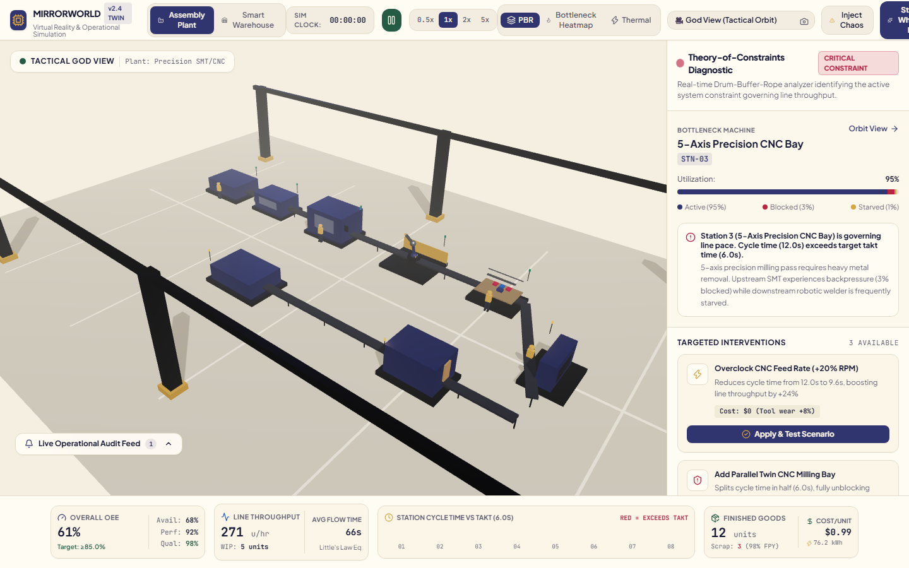
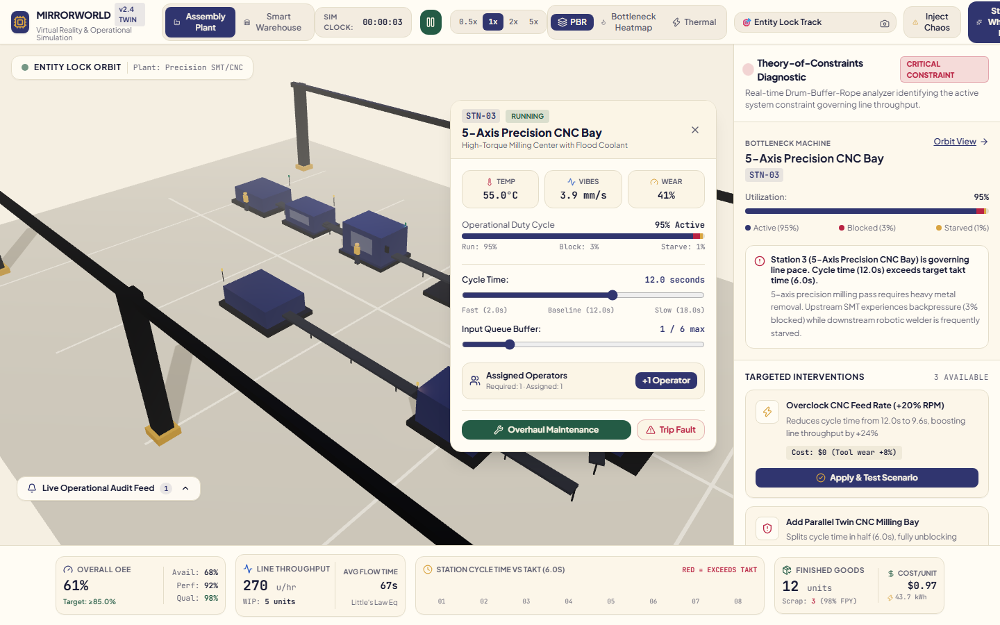
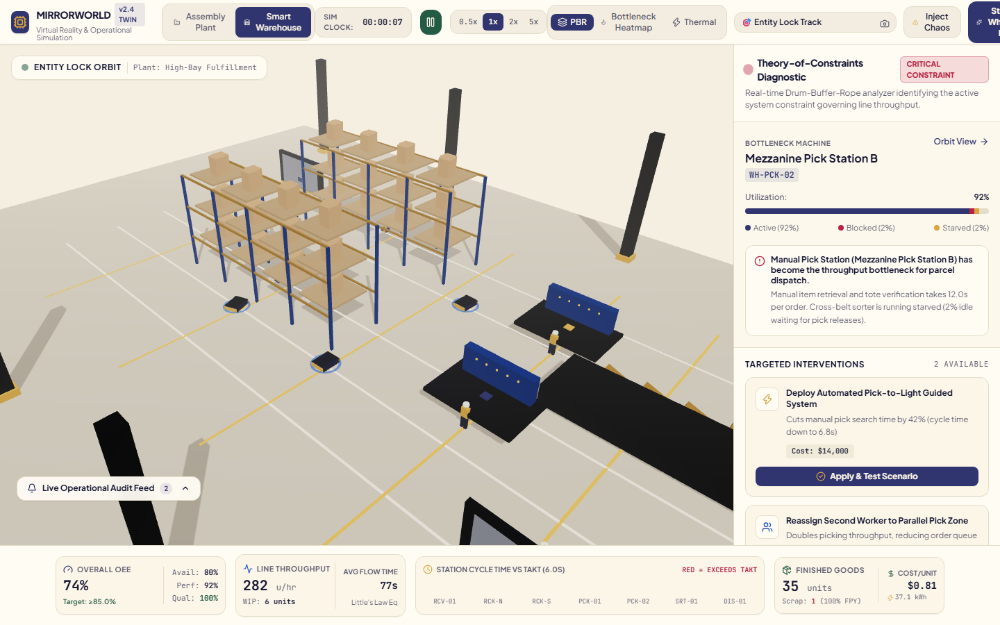
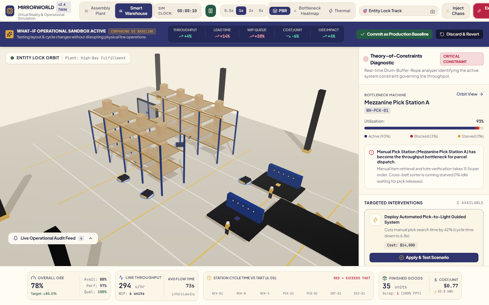
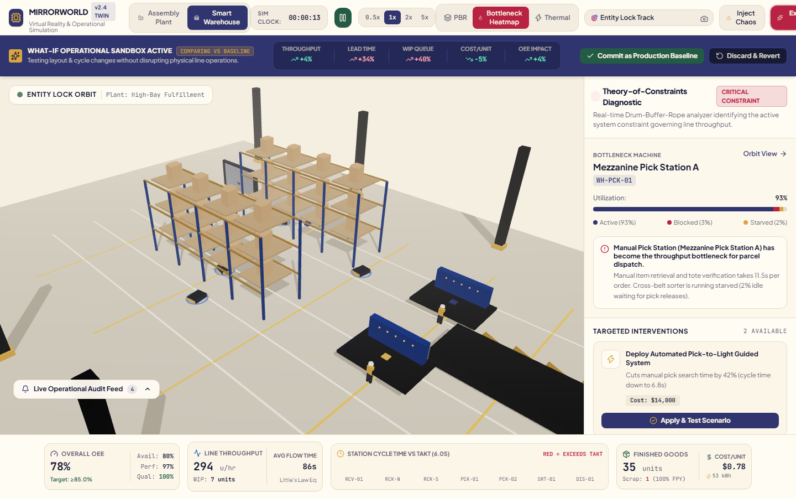
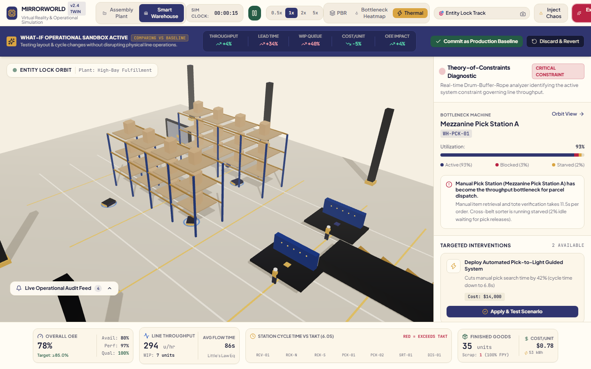
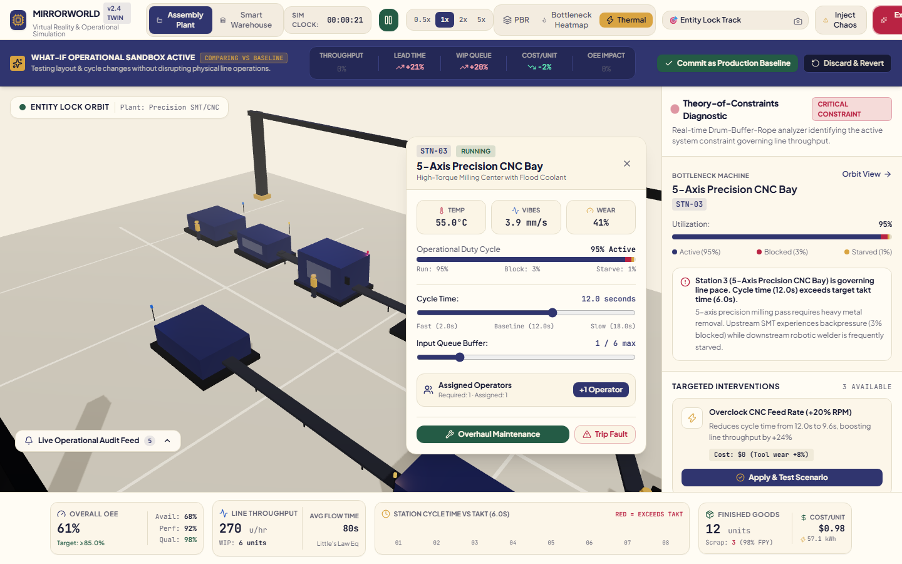

# 🌐 MIRRORWORLD — Virtual Reality of Your Business
## Industrial Digital Twin, Discrete-Event Simulation & Operational Bottleneck Optimization Engine

> 🏭 **Executive Summary:** MIRRORWORLD is a high-fidelity 3D Virtual Reality & Digital Twin platform that replicates real-world business operations, factory floors, and warehouse fulfillment centers. Powered by a deterministic discrete-event simulation (DES) core and Goldratt's Theory of Constraints (TOC), MIRRORWORLD empowers operations leaders, plant managers, and industrial engineers to test production layout changes, evaluate capital investments, balance line takt time, eliminate bottlenecks, and simulate autonomous robotic and human workflows in real time.
>
> 🎨 **Aesthetic Direction:** Grounded Industrial Editorial & Tactical Minimalist. Palette: **Midnight Indigo & Vanilla** (`#30356F` / `#FBF5E6`) with warm amber (`#D9A441`) and alert crimson (`#B92343`) from the `colours for websites` design system. Strictly zero sci-fi neon or gimmick wireframes—pure tactile manufacturing realism.

---

## 📋 Project Properties & Metadata

| Property | Specification / Value |
| :--- | :--- |
| **System Name** | MIRRORWORLD — Industrial Digital Twin |
| **Workspace** | `l:\pr 14(MIRRORWORLD)` |
| **Live Production URL** | [mirrorworld-amber.vercel.app](https://mirrorworld-amber.vercel.app) |
| **Target GitHub Repository** | [KARTHIKEYASHARMA672/mirrorworld](https://github.com/KARTHIKEYASHARMA672/mirrorworld) (Public) |
| **Local Runtime Port** | `http://localhost:4174` |
| **Frontend Framework** | React 19, TypeScript 5.8+, Vite 6, Tailwind CSS v4 |
| **3D WebGL Engine** | Three.js (`three@0.187.0`), PCF Soft Shadows, ACES Filmic Tone Mapping |
| **Simulation Core** | Deterministic Discrete-Event Queue Engine (DES) + Kinematic Interpolator |
| **Diagnostic Framework** | Eliyahu M. Goldratt's Theory of Constraints (Drum-Buffer-Rope) & Little's Law |
| **Verification Suite** | Vitest (8/8 automated unit tests passing, 100% clean builds) |
| **Author / Engineer** | Karthikeya Sharma (`KARTHIKEYASHARMA672`) |

---

## 🖼️ Verified Visual Verification Gallery

| 01. Precision Assembly Plant (3D God View) | 02. Theory-of-Constraints Bottleneck Diagnoser |
| :---: | :---: |
|  |  |
| *SMT mounter, 5-axis CNC bay, 6-axis robotic arm, manual ESD cells & Andon status towers* | *Real-time Goldratt Drum-Buffer-Rope analyzer identifying CNC Station 3 governing line speed* |

| 03. Smart Warehouse & Autonomous AGV Fleet | 04. Warehouse Mezzanine Pick Bottleneck |
| :---: | :---: |
|  |  |
| *5-tier pallet racking matrix, AMRs/AGVs with spinning LiDAR pucks & blue safety projection rings* | *Mezzanine pick-to-light order consolidation deck pacing fulfillment throughput* |

| 05. What-If Operational Experimentation Sandbox | 06. Bottleneck Heatmap Layer (Color-Coded Flow) |
| :---: | :---: |
|  |  |
| *Comparative A/B testing with real-time deltas for Throughput, Flow Time, WIP, Cost/Unit & OEE* | *Dynamic visual heatmap highlighting starving upstream vs blocked downstream stations* |

| 07. Thermal & Energy Power Distribution | 08. Deep Entity Inspector Drawer |
| :---: | :---: |
|  |  |
| *Real-time thermal load and power dissipation monitoring across active machinery* | *Live temperature, vibration, tool wear, cycle time slider, and operator reassignment dials* |

---

## 🧭 Table of Contents

1. [Key Features & Capabilities](#1-key-features--capabilities)
2. [Dual Facility Environments](#2-dual-facility-environments)
3. [Theory-of-Constraints Bottleneck Detection](#3-theory-of-constraints-bottleneck-detection)
4. [What-If Operational Experimentation (A/B Testing)](#4-what-if-operational-experimentation-ab-testing)
5. [Operational KPIs & Mathematical Foundations](#5-operational-kpis--mathematical-foundations)
6. [3D Camera & Visual Heatmap Modes](#6-3d-camera--visual-heatmap-modes)
7. [System Architecture & File Structure](#7-system-architecture--file-structure)
8. [Installation & Local Deployment Guide](#8-installation--local-deployment-guide)

---

## 1. 🚀 Key Features & Capabilities

- **Digital Twin Reproduction:** Replicates multi-station precision assembly factories and autonomous logistics warehouses down to physical kinematics, conveyor roller speeds, buffer capacities, and worker ergonomic fatigue.
- **Physical Kinematics in 3D WebGL:** Animated 6-axis articulated welding robots, rotating high-speed CNC spindles, optical scanning laser fans, Andon status towers, and autonomous mobile robots (AMRs/AGVs) with spinning LiDAR sensors.
- **Autonomous AGV Fleet Simulation:** Dynamic waypoint navigation, obstacle safety rings, battery discharge/recharge cycles, and pallet transport logistics.
- **Human Workforce Dynamics:** Simulates operators walking, working, and resting with fatigue curves and individual skill efficiency factors.
- **Automated Bottleneck Detection:** Algorithmic constraint ranking identifying whether slowdowns stem from cycle time imbalances, buffer starvation, downstream blocking, or operator shortages.
- **Actionable Optimization Interventions:** 1-click testable interventions that automatically model overclocking feeds, adding parallel machines, or expanding infeed buffers.
- **What-If Scenario Sandbox:** Compares experimental parameter modifications against the production baseline with real-time delta indicators ($\Delta$ Throughput, $\Delta$ Flow Time, $\Delta$ WIP, $\Delta$ Cost/Unit, $\Delta$ OEE).
- **Chaos Injection Suite:** Stress-test facility resilience by injecting spontaneous machine faults, customer demand surges (+54%), and operator call-outs.

---

## 2. 🏭 Dual Facility Environments

### Facility A: Precision Assembly Plant (High-Tech Electronics & Micro-Mobility)
1. **STN-01 Inbound Staging Dock:** Automated roller infeed de-palletizing raw circuit boards and casings.
2. **STN-02 High-Speed SMT Mounter:** Dual-gantry surface mount chip shooter (32,000 CPH) placing micro-components.
3. **STN-03 5-Axis Precision CNC Bay:** Heavy casting milling bay with spinning spindle and flood coolant *(Primary line pacing constraint)*.
4. **STN-04 6-Axis Robotic Welder:** Articulated industrial robotic arm executing multi-point structural laser welds.
5. **STN-05 Ergonomic Manual Assembly Cell:** Tactile ESD bench with torque tools, parts bins, and certified technician.
6. **STN-06 Optical Scanner & QA Bay:** 3D telecentric vision and laser profilometry scanning for solder bridges and defects.
7. **STN-07 Automated Case Packager:** Carton forming, protective packaging, and case sealing.
8. **STN-08 Outbound Logistics Dispatch Dock:** Final roll-door staging for finished goods transport.

### Facility B: Smart Autonomous Logistics Fulfillment Warehouse
1. **WH-RCV-01 Container Receiving Dock:** Inbound freight de-containerizing and barcode verification.
2. **WH-RCK-N / S High-Bay Pallet Racks Matrix:** Multi-tier heavy-duty structural steel racking with stored pallets and corrugated cartons.
3. **AMR Atlas & Swift Fleet:** 4 active autonomous guided vehicles navigating marked floor guideways with LiDAR safety cones.
4. **WH-PCK-01 / 02 Mezzanine Pick Stations:** Pick-to-light order consolidation decks with manual order fulfillment operators.
5. **WH-SRT-01 Automated Cross-Belt Sorter:** High-speed parcel sorting loop with pneumatic diverter chutes.
6. **WH-DIS-01 Outbound Freight Loading Dock:** Dock levelers and trailer loading bays.

---

## 3. 🎯 Theory-of-Constraints Bottleneck Detection

MIRRORWORLD implements Eliyahu M. Goldratt’s **Theory of Constraints (TOC)**:
- **Constraint Identification:** Computes a composite constraint score based on cycle time vs. takt ratio ($C_t / T_{takt}$), upstream blockage frequency ($B_{upstream}$), downstream starvation frequency ($S_{downstream}$), input queue fill ratio, and active machine duty cycle.
- **Victim vs. Culprit Distinction:** Subtracts self-starvation to prevent penalizing downstream machines that are idle merely because an upstream machine is starved.
- **Root Cause Categorization:**
  - `cycle_time`: Machine processing cycle time exceeds the line takt time.
  - `buffer_blocking`: Downstream queue saturation forces upstream machines to halt.
  - `buffer_starvation`: Machine sits idle waiting for intermittent material arrivals.
  - `worker_shortage`: Operators assigned are less than required for rated line speed.
  - `maintenance_risk`: High cumulative wear ($>70\%$) or excessive vibration causing micro-stops.

---

## 4. 🧪 What-If Operational Experimentation (A/B Testing)

MIRRORWORLD isolates experiments inside an active virtual sandbox:
- **Clone Baseline:** Takes an immutable snapshot of baseline facility parameters and KPIs.
- **Tweak Operational Levers:**
  - Adjust machine cycle times via interactive sliders (2.0s to 18.0s).
  - Expand input buffer capacities (2 to 24 units).
  - Deploy additional human operators or reassign workers to starving cells.
  - Overhaul equipment to clear mechanical wear and thermal buildup.
- **Comparative Delta Analytics:**
  - $\Delta$ **Throughput (%)**: Realized units produced per hour.
  - $\Delta$ **Lead Time (%)**: Average flow transit time from raw material to dispatch.
  - $\Delta$ **WIP Queue (%)**: Units trapped in buffers across the facility floor.
  - $\Delta$ **Unit Cost (%)**: Amortized energy, labor, and tooling cost per unit.
  - $\Delta$ **OEE Impact (%)**: Availability $\times$ Performance $\times$ Quality delta.
- **Commit or Revert:** 1-click **Commit as Production Baseline** or **Discard & Revert** to restore original factory settings.

---

## 5. 📊 Operational KPIs & Mathematical Foundations

### Overall Equipment Effectiveness (OEE)
$$\text{OEE} = \text{Availability} \times \text{Performance} \times \text{Quality}$$
- **Availability ($A$):** $\frac{\text{Operating Run Time}}{\text{Planned Production Time}}$
- **Performance ($P$):** $\frac{\text{Ideal Baseline Cycle Time}}{\text{Realized Operating Cycle Time}}$
- **Quality ($Q$):** $\frac{\text{Total Processed} - \text{Scrap Defect Units}}{\text{Total Processed}}$

### Little's Law Flow Equation
$$WIP = \text{Throughput Rate} \times \text{Average Lead Time}$$
$$\text{Average Flow Time} = \frac{WIP}{\lambda}$$

### Unit Economics
$$\text{Cost Per Unit} = \frac{\text{Hourly Energy Cost} + \text{Hourly Labor Cost} + \text{Tooling Amortization}}{\text{System Hourly Throughput}}$$

---

## 6. 🎥 3D Camera & Visual Heatmap Modes

| Camera Mode | Description | Control Schema |
| :--- | :--- | :--- |
| **Tactical God View** | Panoramic isometric view of entire facility | Drag mouse to orbit, scroll to zoom |
| **First-Person Operator** | Eye-level walkthrough at 1.7m operator height | `WASD` keys to walk, drag mouse to look |
| **Product Telemetry Cam** | Rides along with leading product through line | Automated tracking on active items |
| **Entity Lock Orbit** | Focuses and orbits around a selected machine or worker | Click any entity in 3D to lock |
| **VR Spatial Mode** | Stereoscopic preview with spatial depth cues | Dual-perspective inspection |

### Visual Overlay Heatmap Layers
- **PBR Standard:** Realistic concrete, painted machinery, brushed aluminum, and safety amber.
- **Bottleneck Heatmap:** Machine beacons and floor areas dynamically turn crimson for governing constraints and amber for starved cells.
- **Thermal & Energy:** Real-time temperature gradient highlighting thermal hotspots ($>45^\circ\text{C}$).

---

## 7. 📁 System Architecture & File Structure

```
l:\pr 14(MIRRORWORLD)\
├── dist/                          # Production-optimized distribution bundle
├── src/
│   ├── components/
│   │   ├── 3d/
│   │   │   ├── DigitalTwinCanvas.tsx   # Three.js WebGL renderer, raycaster, camera controls
│   │   │   ├── Factory3DScene.ts       # Procedural factory scene (SMT, CNC, robot, conveyor)
│   │   │   └── Warehouse3DScene.ts     # Procedural warehouse scene (racks, AGVs, mezzanines)
│   │   └── ui/
│   │       ├── TopNavigationBar.tsx    # Header, facility switch, clock, playback, chaos menu
│   │       ├── BottleneckAdvisorPanel.tsx # Theory-of-Constraints diagnostic & 1-click recommendations
│   │       ├── KpiExecutiveDashboard.tsx  # OEE gauges, Takt/Cycle chart, Little's Law monitor
│   │       ├── ScenarioExperimentBar.tsx  # What-If comparative delta HUD
│   │       ├── EntityInspectorModal.tsx   # Live telemetry dials, cycle slider, maintenance actions
│   │       └── EventAuditStream.tsx       # Live chronological operational feed
│   ├── simulation/
│   │   ├── simulationEngine.ts    # Master deterministic discrete-event loop
│   │   ├── factoryLayout.ts       # Initial factory machine, worker, and conveyor specs
│   │   ├── warehouseLayout.ts     # Initial warehouse machine, AGV, and conveyor specs
│   │   ├── bottleneckDetector.ts  # Goldratt TOC scoring algorithm
│   │   ├── kpiCalculator.ts       # OEE, Little's Law, and unit economics formulas
│   │   └── __tests__/
│   │       └── simulation.test.ts # Vitest suite (8/8 unit tests)
│   ├── types/
│   │   └── simulation.ts          # Core domain TypeScript interfaces
│   ├── App.tsx                    # Root reactive state coordinator
│   ├── index.css                  # Tailwind CSS v4 design tokens
│   └── main.tsx                   # React 19 entry point
├── index.html                     # HTML shell with Plus Jakarta Sans & JetBrains Mono
├── package.json                   # Project manifests & dependencies
├── vite.config.ts                 # Vite bundler & Tailwind v4 plugin
└── tsconfig.json                  # Strict TypeScript configuration
```

---

## 8. 💻 Installation & Local Deployment Guide

### Prerequisites
- Node.js `v20.0+` (Tested on `v24.14.1`)
- npm `v10.0+` (Tested on `11.11.0`)

### Quick Start
```powershell
# 1. Clone repository
git clone https://github.com/KARTHIKEYASHARMA672/mirrorworld.git
cd mirrorworld

# 2. Install dependencies
npm install

# 3. Run automated verification test suite
npm test

# 4. Build production bundle
npm run build

# 5. Launch local digital twin preview server
npm run preview
```
Visit **`http://localhost:4174`** in Chrome, Edge, or Firefox.
